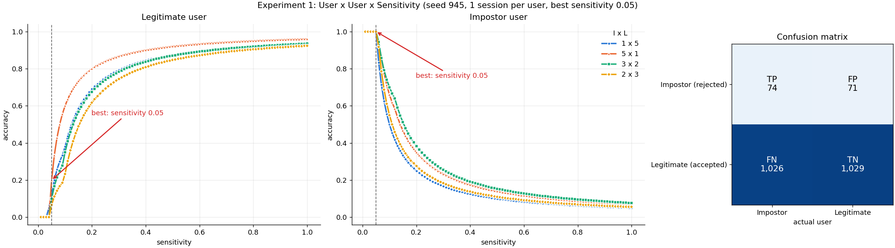
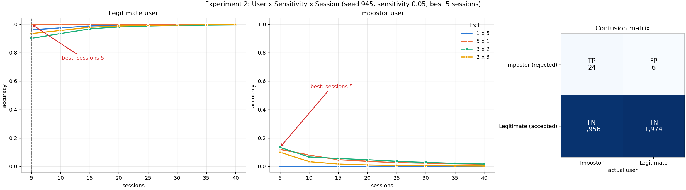

# CHAPTER IV

## INITIAL RESULTS

This chapter presents the results of each process described in Chapter III, in the same order: data acquisition and
organization, data preprocessing and segmentation, feature extraction, Euclidean distance measurement, and performance
evaluation. The results come from one random draw of users and session orders (seed 945). Splits are written as
legitimate users × impostors: 1×5 means one legitimate user and five impostors.

### Data Acquisition and Organization

The researchers successfully acquired and organized the Balabit Mouse Dynamic dataset as the main source of mouse data
for the study. The dataset contains mouse movement records from 10 users with a total of 1,676 sessions, which provides
the needed movement information to evaluate the behavioral patterns of individual users.

The dataset was organized based on the corresponding user and session, which allows the researchers to identify the
owner of each session and retrieve the mouse movement records needed for the next process. Of the 1,676 sessions, 405
are marked as illegal in the dataset's labels, meaning that they were recorded by other users of the dataset to
simulate attacks. These were excluded, leaving 1,271 sessions (Table 4.1).

**Table 4.1.** Sessions per user

| User | Sessions in the dataset | Marked as illegal (excluded) | Sessions used |
|---|---:|---:|---:|
| user7 | 158 | 37 | 121 |
| user9 | 130 | 43 | 87 |
| user12 | 240 | 49 | 191 |
| user15 | 253 | 70 | 183 |
| user16 | 201 | 38 | 163 |
| user20 | 114 | 20 | 94 |
| user21 | 121 | 22 | 99 |
| user23 | 142 | 33 | 109 |
| user29 | 124 | 20 | 104 |
| user35 | 193 | 73 | 120 |
| **Total** | **1,676** | **405** | **1,271** |

The result of this process is an organized mouse movement dataset that contains the recorded sessions of the users,
which serves as the foundation for the preprocessing, segmentation, and feature extraction procedures.

### Data Preprocessing and Segmentation

After cleaning, every session was divided into strokes using the 0.5-second pause and mouse-click rules, and strokes
with fewer than 10 points were discarded. This produced 109,948 strokes, of which 106,320 (96.7 percent) are move
strokes and 3,628 (3.3 percent) are drag strokes. Every stroke could be moved to the origin (0, 0) and scaled by its
bounding-box diagonal, so all strokes were kept (Table 4.2).

**Table 4.2.** Strokes per user after segmentation

| User | Sessions | Strokes | Move | Drag |
|---|---:|---:|---:|---:|
| user7 | 121 | 14,790 | 14,027 | 763 |
| user9 | 87 | 9,674 | 9,424 | 250 |
| user12 | 191 | 17,023 | 16,341 | 682 |
| user15 | 183 | 12,111 | 11,599 | 512 |
| user16 | 163 | 14,606 | 14,092 | 514 |
| user20 | 94 | 9,495 | 9,099 | 396 |
| user21 | 99 | 7,845 | 7,776 | 69 |
| user23 | 109 | 8,273 | 8,158 | 115 |
| user29 | 104 | 8,399 | 8,230 | 169 |
| user35 | 120 | 7,732 | 7,574 | 158 |
| **All** | **1,271** | **109,948** | **106,320** | **3,628** |

**Best sensitivity and number of sessions.** The strokes were then matched with Dynamic Time Warping to find the best
sensitivity and the best number of sessions for building each user's profile. This was done in two experiments on the
four splits. Each tested session is one decision, with the impostor as the positive class: an impostor session that
is rejected is a true positive (TP), an impostor session that is accepted is a false negative (FN), a legitimate
session that is accepted is a true negative (TN), and a legitimate session that is rejected is a false positive (FP).
The best setting is the one with the highest accuracy, (TP + TN) / (TP + TN + FP + FN), over all four splits
together.

*Experiment 1 (best sensitivity).* Each user was given one session, and the sensitivity was tested from 0.01 to 1.00
in steps of 0.01. Figure 4.1 shows the results. The legitimate users' accuracy rises with the sensitivity, while the
impostors' accuracy falls, since a higher sensitivity lets more strokes of any user match. The highest accuracy was
reached at a sensitivity of 0.05, with 0.73 (Table 4.3).

**Figure 4.1.** Experiment 1: accuracy of the legitimate users (left) and the impostors (right) per sensitivity, with
one session per user, and the confusion matrix (right). The legend lists the splits as impostors × legitimate users
(I × L), as in Tables 4.3 and 4.4 (the text of this chapter uses L × I). The lines and the confusion matrix add the counts
of each sensitivity to those before it.

**Table 4.3.** Experiment 1 at the best sensitivity (0.05, one session)

| Split (I × L) | TP | FP | FN | TN | Accuracy |
|---|---:|---:|---:|---:|---:|
| 1×5 | 1 | 3 | 0 | 2 | 0.50 |
| 5×1 | 5 | 0 | 0 | 1 | 1.00 |
| 3×2 | 3 | 1 | 0 | 1 | 0.80 |
| 2×3 | 2 | 2 | 0 | 1 | 0.60 |
| **All** | **11** | **6** | **0** | **5** | **0.73** |

At a sensitivity of 0.05, all 11 impostor sessions were rejected (FAR = 0 / 11 = 0.0%), but 6 of the 11 legitimate
sessions were also rejected (FRR = 6 / 11 = 54.5%). The confusion matrix in Figure 4.1 adds the counts of all 100
sensitivities and all four splits: TP = 74, FP = 71, FN = 1,026 and TN = 1,029, an accuracy of 1,103 / 2,200 = 0.50.

*Experiment 2 (best number of sessions).* The best sensitivity of experiment 1 (0.05) was kept, and the number of
sessions per user was tested from 5 to 40 in steps of 5. Figure 4.2 shows the results. The legitimate users' accuracy
stays between 0.90 and 1.00 for every number of sessions, while the impostors' accuracy stays below 0.15 and falls as
sessions are added, since a larger library gives an impostor's strokes more strokes to match. The highest accuracy
was reached with 5 sessions, with 0.53 (Table 4.4).

**Figure 4.2.** Experiment 2: accuracy of the legitimate users (left) and the impostors (right) per number of
sessions at a sensitivity of 0.05, and the confusion matrix (right). The legend lists the splits as impostors ×
legitimate users (I × L). The lines and the confusion matrix add the counts of each number of sessions to those
before it.

**Table 4.4.** Experiment 2 at the best number of sessions (sensitivity 0.05, 5 sessions)

| Split (I × L) | TP | FP | FN | TN | Accuracy |
|---|---:|---:|---:|---:|---:|
| 1×5 | 0 | 1 | 5 | 24 | 0.80 |
| 5×1 | 3 | 0 | 22 | 5 | 0.27 |
| 3×2 | 2 | 1 | 13 | 9 | 0.44 |
| 2×3 | 1 | 1 | 9 | 14 | 0.60 |
| **All** | **6** | **3** | **49** | **52** | **0.53** |

With 5 sessions, 52 of the 55 legitimate sessions were accepted (FRR = 3 / 55 = 5.5%), but 49 of the 55 impostor
sessions were also accepted (FAR = 49 / 55 = 89.1%). The confusion matrix in Figure 4.2 adds the counts of all eight
session numbers and all four splits: TP = 24, FP = 6, FN = 1,956 and TN = 1,974, an accuracy of 1,998 / 3,960 = 0.50.

The best values were chosen on the same sessions that they score, so they are likely optimistic, and experiment 1
rests on one session per user. The result of this process is a set of strokes organized by session and movement
type, together with the best sensitivity (0.05) and number of sessions (5), prepared for feature extraction.

### Feature Extraction

From the sessions of the 5×1 split, the first 0.5-second stroke of every tested session was aligned at (0, 0) and pooled
per user. A convex hull was built around each user's pooled points and refined into a concave hull, and each outline
was resampled to 64 evenly spaced points. Table 4.5 shows the resulting hulls.

**Table 4.5.** Convex and concave hulls of each user's pooled strokes

| User | Strokes (passed) | Convex area (px²) | Concave corners | Concave area (px²) | Concave / convex |
|---|---|---:|---:|---:|---:|
| user9 | 25 (23) | 584,226 | 50 | 236,902 | 40.5% |
| user15 | 25 (9) | 1,648,464 | 36 | 583,712 | 35.4% |
| user16 | 25 (12) | 695,418 | 52 | 196,514 | 28.3% |
| user20 | 25 (23) | 703,078 | 75 | 259,444 | 36.9% |
| user23 | 25 (11) | 564,836 | 42 | 217,090 | 38.4% |
| user29 | 25 (18) | 782,606 | 52 | 301,594 | 38.5% |
| user35 | 1 (0) | 305 | 5 | 226 | 74.1% |
| user7 | 1 (0) | 13,642 | 26 | 3,680 | 27.0% |

### Euclidean Distance Measurement

Each of the eight hulls was compared with each of the six profiles of the 5×1 split. The 64 points of the two hulls
were paired from (0, 0), the gap at each point was measured, and the gaps were combined into one distance and divided
by 8 (√64) to give the average gap per point. Table 4.6 shows the results; the values on the diagonal are the genuine
comparisons of each user with their own profile.

**Table 4.6.** Average gap per point (px) of each hull from each profile

| Hull \ Profile | user9 | user15 | user16 | user20 | user23 | user29 |
|---|---:|---:|---:|---:|---:|---:|
| user9 | **91.1** | 796.7 | 394.0 | 384.3 | 420.1 | 523.7 |
| user15 | 650.8 | **462.4** | 818.8 | 539.5 | 591.0 | 854.5 |
| user16 | 693.2 | 466.9 | **612.6** | 532.9 | 514.6 | 637.1 |
| user20 | 353.6 | 624.8 | 463.6 | **2.2** | 257.5 | 484.5 |
| user23 | 345.1 | 720.8 | 422.3 | 283.7 | **122.1** | 418.0 |
| user29 | 538.8 | 872.3 | 291.4 | 484.3 | 418.1 | **7.6** |
| user35 | 503.7 | 627.7 | 312.0 | 450.7 | 431.0 | 446.1 |
| user7 | 620.4 | 760.4 | 275.9 | 546.1 | 481.0 | 372.7 |

For every legitimate user, the genuine distance is the smallest in that user's column. For user9, user20, user23 and
user29, it is also far below the impostor distances (at most 122.1 px against at least 257.5 px). For user15, the
margin is small (462.4 px against 466.9 px for user16), and its genuine distance is larger than many impostor
distances to the other profiles, since only 9 of its 25 sessions passed.

### Performance Evaluation

Each comparison is one authentication attempt: the attempt is accepted as the legitimate user when its distance is at
most the threshold *T*, and rejected otherwise. The evaluation uses the profiles of the five legitimate users of the
5×1 split (user9, user15, user20, user23 and user29), giving 40 attempts: 5 genuine attempts (the diagonal) and 35
impostor attempts. Each attempt falls into one cell of the confusion matrix, with the impostor as the positive class:

| | Actual: Impostor | Actual: Legitimate |
|---|---|---|
| **Rejected** | True Positive (TP): impostor rejected | False Positive (FP): legitimate user rejected |
| **Accepted** | False Negative (FN): impostor accepted | True Negative (TN): legitimate user accepted |

From these counts:

- FAR = FN / (TP + FN), the share of impostor attempts accepted.
- FRR = FP / (FP + TN), the share of genuine attempts rejected.
- Accuracy = (TP + TN) / (TP + TN + FP + FN).
- EER is the error rate at the threshold where FAR = FRR.

The threshold was found by sorting the 40 distances from smallest to largest and sliding *T* across them. Two
thresholds are reported.

**Zero-FAR threshold (T = 122.1 px).** This is the genuine distance of user23, below the lowest impostor distance
(257.5 px). No impostor attempt is accepted, and only user15 is rejected (Table 4.7).

**Table 4.7.** Confusion matrix at T = 122.1 px

| | Actual: Impostor | Actual: Legitimate |
|---|---:|---:|
| **Rejected** | TP = 35 | FP = 1 |
| **Accepted** | FN = 0 | TN = 4 |

FAR = 0 / 35 = 0.0%, FRR = 1 / 5 = 20.0%, and accuracy = 39 / 40 = 97.5%.

**EER threshold (T = 418.0 px).** At this threshold FAR equals FRR. Seven impostor attempts are accepted (Table 4.8):
user20 against user23 (257.5 px), user23 against user20 (283.7 px), user23 against user9 (345.1 px), user20 against
user9 (353.6 px), user7 against user29 (372.7 px), user9 against user20 (384.3 px), and user23 against user29
(418.0 px).

**Table 4.8.** Confusion matrix at T = 418.0 px

| | Actual: Impostor | Actual: Legitimate |
|---|---:|---:|
| **Rejected** | TP = 28 | FP = 1 |
| **Accepted** | FN = 7 | TN = 4 |

FAR = 7 / 35 = 20.0%, FRR = 1 / 5 = 20.0%, so the EER is 20.0%, and accuracy = 32 / 40 = 80.0%. The accepted
impostors are mainly among user9, user20 and user23, whose hulls lie close together.

The zero-FAR threshold was chosen on the same 40 attempts it is evaluated on, and the evaluation covers five
legitimate users, so these values describe this initial experiment only.
