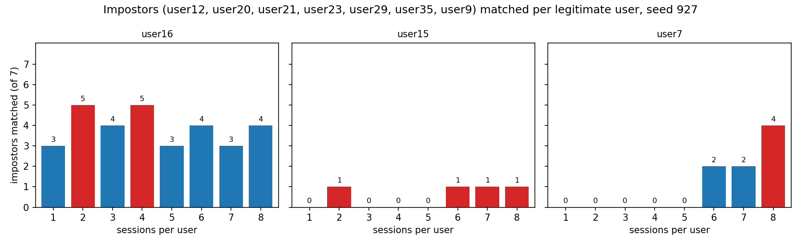
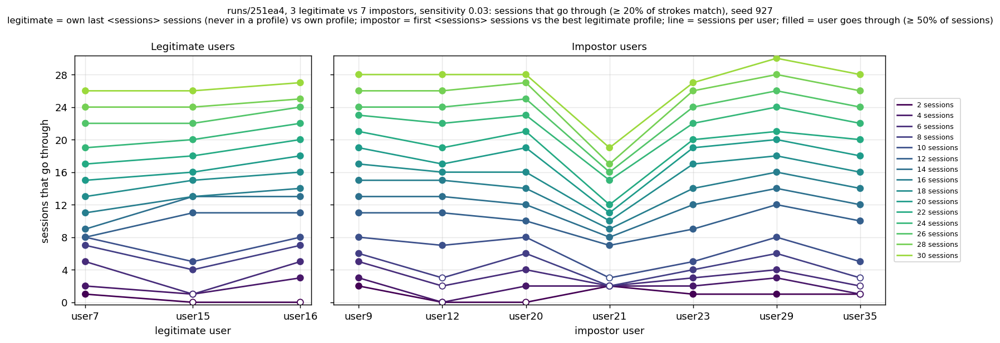
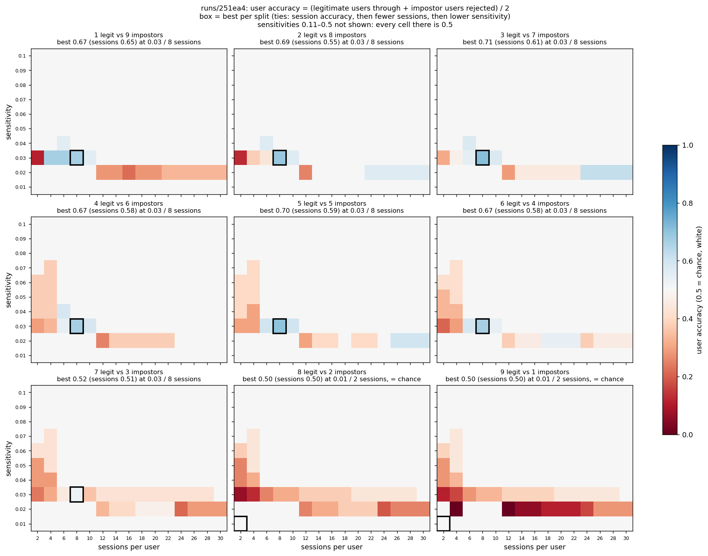
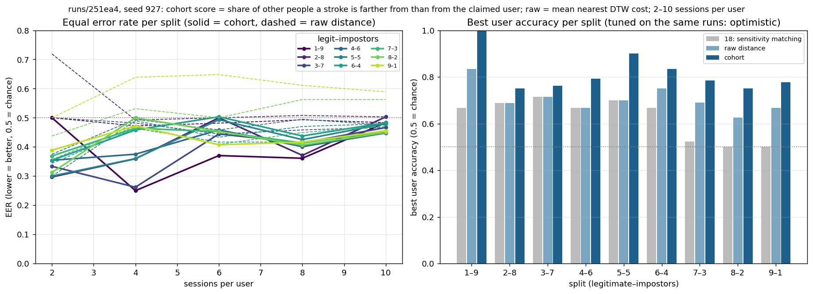
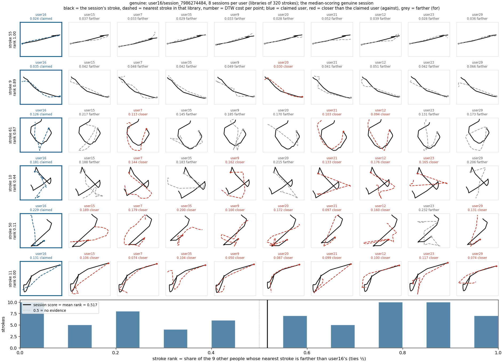
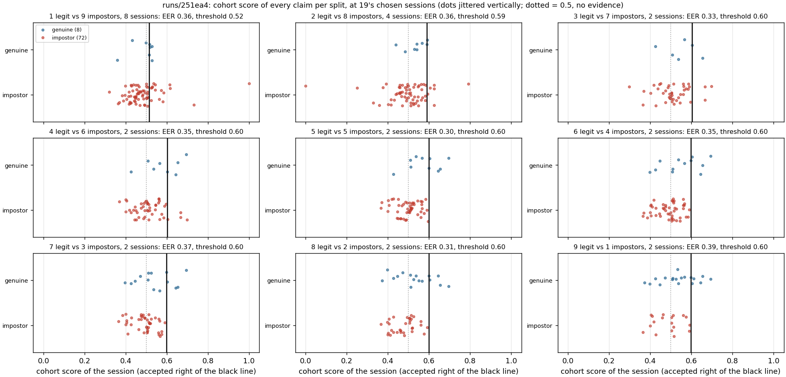
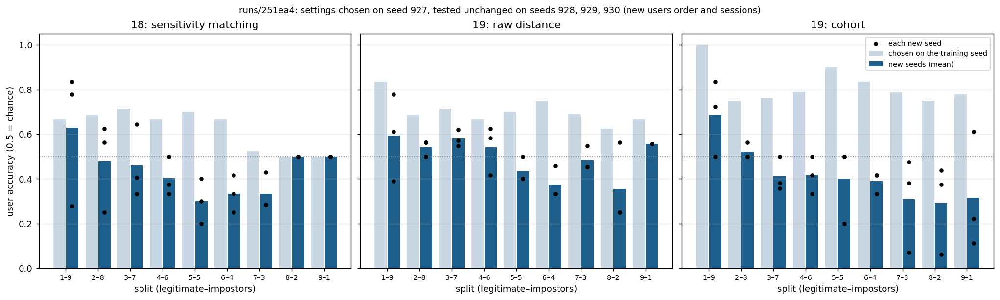

# How to read the figures

Every figure the EARL experiment makes, what one mark in it means, what a good and a bad result look like, and
what we saw so far. How to *make* each figure is in [README.md](README.md); how each script computes it is in
[docs/](docs/README.md).

All examples come from `runs/251ea4/` (seed 927, the batch of 9 splits × 50 sensitivities × 15 session counts),
unless a section says otherwise. `runs/` is git-ignored, so copies of the example figures live in
[docs/figures/](docs/figures/); your own figures are in the run folders named under each heading.

## Contents

1. [Words used in every figure](#1-words-used-in-every-figure)
2. [Which figures to read, in what order](#2-which-figures-to-read-in-what-order)
3. [Shapes of single strokes](#3-shapes-of-single-strokes-c) (C)
4. [Notebook: one run, sessions 1 → N](#4-notebook-one-run-sessions-1--n-a) (A)
5. [Matched shapes and the genuine check](#5-matched-shapes-and-the-genuine-check-d-e) (D, E)
6. [Sessions through across the runs of a batch](#6-sessions-through-across-the-runs-of-a-batch-f) (F)
7. [The best sensitivity and sessions](#7-the-best-sensitivity-and-sessions-g) (G)
8. [Cohort scoring](#8-cohort-scoring-h) (H)
9. [What cohort scoring does, stroke by stroke](#9-what-cohort-scoring-does-stroke-by-stroke-j) (J)
10. [New-seed check](#10-new-seed-check-i) (I)
11. [Mistakes to avoid when reading them](#11-mistakes-to-avoid-when-reading-them)

The letters match the sections of [README.md](README.md).

---

## 1. Words used in every figure

| Word | Meaning |
|---|---|
| **Session** | One Balabit recording file. It belongs to the user whose folder it is in. |
| **Stroke** (chunk, shape) | A piece of mouse movement between two pauses or clicks. Strokes are moved to start at (0, 0), scaled to the same size and redrawn with 64 points before they are compared, so only the *shape* is left. |
| **Profile / library** | The strokes of a legitimate user's first *k* sessions. New sessions are compared against it. |
| **Legitimate user** | The user a profile belongs to. Their own unused sessions *should* match. |
| **Impostor** | Any other user. Their sessions *should not* match. |
| **Split** `L–I` | `L` legitimate users and `I` impostors from one draw, e.g. `3–7`. Always 10 users in total. |
| **Sessions per user** (*k*) | How many sessions build each profile and how many are tested per user. |
| **Sensitivity** | The DTW tolerance: two strokes match when their distance per point is at most this. **Lower = stricter.** Around 0.15 almost everything matches. (In the notebook heatmap, *sensitivity* is also the share of impostors matched; see section 4.) |
| **A session goes through** | At least `match_shape_ratio` (20%) of its strokes match the profile. |
| **A user goes through** | At least `match_session_ratio` (50%) of their tested sessions go through. For a legitimate user that is good (accepted); for an impostor it is bad (got in). |
| **User accuracy** | (share of legitimate users accepted + share of impostors kept out) / 2. **1 = perfect, 0.5 = chance** (the same as accepting everyone or rejecting everyone). |
| **Session accuracy** | The same, counted over sessions instead of users. Stricter than user accuracy. |
| **EER** (equal error rate) | The error rate at the threshold where "genuine sessions rejected" equals "impostor sessions accepted". **0 = perfect, 0.5 = chance.** It needs no chosen threshold, so it is the fairest single number. |
| **Cohort score** | For each stroke: the share of *other people* whose library is farther from it than the claimed user's. The session score is the mean over its strokes. **0.5 = no evidence** either way. |
| **Seed** | The random number that picks the users, the split and every session order. Same seed = same draw. |

**Chance is 0.5 everywhere.** Any accuracy near 0.5, or any EER near 0.5, means the method cannot tell users
apart in that setting, however the bars or colours look.

## 2. Which figures to read, in what order

For the thesis question ("do short mouse strokes identify a user?"):

1. **Section 3 (shape PNGs)** and **section 5 (matched shapes)**: what strokes look like, and why they match across
   users.
2. **Section 6 (sessions through)**: the raw counts per user for every run.
3. **Section 7 (best heatmaps)**: which sensitivity and session count work best per split.
4. **Sections 8 and 9 (cohort)**: whether comparing against other people helps, and why it mostly does not.
5. **Section 10 (seed check)**: whether any of the "best" settings hold on new users and sessions. **This is the
   figure that decides what can be claimed.**

---

## 3. Shapes of single strokes (C)

**File:** `runs/<hash>/<run>/shapes/<legitimate|impostor>/<user>/<session>/chunk_NNNN_<move|drag>.png` and
`overview.png` (the first 100 strokes of a session in a grid).

- **One image = one stroke**, in real screen coordinates (y grows downward, as on the screen).
- Green dot = start, red dot = end. Blue line = mouse move, orange line = drag (a button held).
- The title gives the stroke number, its length in pixels and its duration.

**What to look for:** how many strokes are near-straight lines. Those are the strokes that later match everyone.

## 4. Notebook: one run, sessions 1 → N (A)

Folder: `runs/<hash>/<run>/figures/`. One draw from the seed fixes the users and sessions; the profile grows one
session at a time (step *k* + 1 keeps the sessions of step *k*).

### `session_progression.png`: impostors matched per session step

- **x** = sessions per user (1, 2, … `sessions_per_user`). **y** = how many impostor users matched at least one
  legitimate profile.
- **Lower is better.** A good method keeps the bars low while the profile grows.
- Bars that rise with *k* mean a bigger profile lets more impostors in.

### `session_progression_users.png`: the same count, one panel per legitimate user

- One panel per legitimate user; each bar = impostors (of all `I`) that matched **that** user's profile at that
  session step. The tallest bar of each panel is red.
- Compare panels: a user whose bars are always high (here user16, 3–5 of 7) has a "permissive" profile that
  impostors match easily; a user near 0 (user15) is hard to imitate.

### `session_progression_heatmap.png`: sessions × legitimate users

- **y** = sessions per user, **x** = number of legitimate users (the first 1, 2, … of the draw).
- **Colour = sensitivity in the notebook's sense: impostors matched / impostors** (0 = no impostor got in = best,
  1 = every impostor got in). Each cell also prints the count, e.g. `0.57 (4 of 7)`.
- Columns that are all the same (as in the example) mean the first legitimate user already matches every impostor
  that the others would; adding users adds nothing.

## 5. Matched shapes and the genuine check (D, E)

- **`figures/matches/<user>_sessions<k>.png`** (script 08): each panel is one matched pair after normalization: the
  legitimate user's stroke (blue) and the impostor stroke that matched it (red dashed), start in green, with the DTW
  cost per point. The title repeats each impostor's verdict. **What we saw:** most matched pairs are near-straight
  lines, which look the same for everyone after normalization.
- **`figures/genuine_check.png`** (script 09): one panel per legitimate user; blue bars = share of strokes matched
  in the user's **own** unused sessions, red bars = the impostors' share, per session step; labels =
  sessions passed / tested; dotted line = `match_shape_ratio`. **Good result:** blue clearly above red and above the
  dotted line.

## 6. Sessions through across the runs of a batch (F)

**File:** `runs/<hash>/accuracy_<L>_<I>_sensitivity_<value>.png` (script 10), one per split and sensitivity
(450 for `251ea4`).

- **Left panel, legitimate users:** x = each legitimate user; **y = how many of their own last *k* sessions** (never
  used in a profile) go through their own profile. **Higher is better.**
- **Right panel, impostor users:** x = each impostor; **y = how many of their first *k* sessions** go through the
  legitimate profile that lets most of them in. **Lower is better.**
- **One line per sessions per user** (dark = 2 sessions, light = 30). The y axis goes up to *k*, so a line at the top
  of its range means *every* tested session went through.
- **Filled marker** = the user as a whole goes through (≥ 50% of sessions); **hollow** = rejected.

**How to read the example:** at sensitivity 0.03 the legitimate lines and the impostor lines rise together and to
the same height. At 30 sessions, user7 passes 26 of 30 own sessions, but user29 passes 30 of 30 as an impostor.
The method cannot separate them: whatever lets the legitimate user in also lets the impostors in. Only user21 is
consistently harder to pass as.

**Also in the hash folder:** `summary/README.md` (written by the batch, script 11): a table of every run (legitimate
passed and accepted, impostors passed and through) with links to these figures.

## 7. The best sensitivity and sessions (G)

**File:** `runs/<hash>/best/best_heatmaps.png` (script 12).

- **One panel per split.** **y** = sensitivity, **x** = sessions per user. Sensitivities above 0.10 are left out
  (the title says so), because every cell there is exactly 0.5: everyone goes through.
- **Colour = user accuracy around chance:** white = 0.5 (chance), **blue = better than chance**, **red = worse than
  chance** (more impostors than legitimate users get through).
- **Black box** = the best cell of that split; the panel title gives its value, e.g. `best 0.71 (sessions 0.61) at
  0.03 / 8 sessions`. "= chance" means no cell beat 0.5.

**How to read the example:** almost all the colour is in one thin band at sensitivity 0.02–0.04; the rest is
white. The best cell is 0.03 / 8 sessions in 7 of 9 splits, at 0.52–0.71. In 8–2 and 9–1 nothing beats chance, so
the "best" box sits on 0.01 / 2 sessions, where nobody goes through.

**Also in `best/`:** `best.csv` (the boxed cells), `scores.csv` (every cell) and a copy of section 6's figure for
each chosen split and sensitivity.

## 8. Cohort scoring (H)

**File:** `runs/<hash>/cohort/cohort.png` (script 13).

- **Left, EER per split:** x = sessions per user, **y = EER (lower = better, 0.5 = chance, dotted line)**. Solid
  lines with dots = cohort score, dashed = raw distance; one colour per split.
- **Right, best user accuracy per split:** grey = script 12's sensitivity matching, light blue = raw distance,
  dark blue = cohort. **Higher = better, 0.5 = chance.** The title warns that these are tuned on the same sessions.

**How to read the example:** the solid lines sit below the dashed ones in most splits and session counts (at 2–4
sessions, cohort EER 0.25–0.50 against raw 0.30–0.72), so comparing with other people helps there; both rise
toward 0.45–0.50 by 10 sessions. On the
right, cohort is the tallest bar in every split. The right panel is optimistic: section 10 shows how much of it
survives on new seeds.

## 9. What cohort scoring does, stroke by stroke (J)

Folder: `runs/<hash>/cohort/plots/` (script 15).

### `claim_<user>_genuine.png`, `claim_<user>_impostor_typical.png`, `claim_<user>_impostor_top.png`

One session claiming to be `<user>`: the median genuine session, the median impostor session and the
highest-scoring impostor session.

- **Each row = one stroke of the session**, drawn in black in every cell of the row. The rows are picked from the
  highest-ranking stroke (top) to the lowest (bottom).
- **First column (blue frame):** the dashed blue stroke is the **nearest stroke in the claimed user's profile**; the
  number is their DTW distance per point.
- **Other columns:** the nearest stroke in **each other person's** library, with its distance:
  - **grey "farther"**: that person fits the stroke worse than the claimed user does. **Counts for the claim.**
  - **red "closer"**: that person fits it better. **Counts against the claim.**
- **Row label "rank"** = the share of other people marked farther (ties count half). Rank 1.00 = the stroke looks
  more like the claimed user than like anyone else; 0.00 = everyone else fits it better.
- **Bottom histogram:** the ranks of *all* strokes in the session; the black line is the session score (their mean),
  the dotted line is 0.5.

**How to read the examples:** in the genuine session (user16) some strokes are all grey (stroke 55, rank 1.00),
but just as many are mostly red; the session score is 0.517, barely above 0.5. The typical impostor (user7) looks
the same, with a score of 0.469. Simple strokes (straight lines, plain curves) have a close match in nearly every
library, so whether they land grey or red comes down to tiny distance differences. The top impostor (user35) is a
session with **one stroke** that happens to rank 1.00, so the whole session scores 1.00.

### `scores_per_split.png`: every claim's score

- One panel per split at its chosen sessions per user. **Blue dots (top row)** = genuine sessions, **red dots
  (bottom row)** = impostor sessions; each dot is one session's cohort score (x). The vertical jitter only keeps
  dots apart.
- **Black line** = the acceptance threshold; sessions **right of it are accepted**. Dotted line = 0.5.
- **Good result:** blue dots right of the line, red dots left of it, with a gap between. **What we see:** the two
  rows overlap almost completely around 0.4–0.6. On sessions with 30+ strokes, genuine claims average 0.514 and
  impostor claims 0.499.

## 10. New-seed check (I)

**File:** `runs/<hash>/seed_check/seed_check.png` (script 14).

- **One panel per method:** script 12's sensitivity matching, script 13's raw distance, script 13's cohort.
- Per split: **light bar** = user accuracy on the seed where the setting was chosen (927); **dark bar** = the mean
  over the new seeds (928–930), with the setting **unchanged**; **black dots** = each new seed.
- **0.5 = chance** (dotted line).

**How to read it:** if the dark bars stay near the light ones, the setting works for other users and sessions. If
they fall to about 0.5, the light bar was luck from choosing the best of many settings on the same data.

**What we see:** every method falls to about chance: mean user accuracy 0.63 → 0.44 (matching), 0.70 → 0.50 (raw)
and 0.82 → 0.42 (cohort). Cohort falls the most because it tunes a threshold per split and session count. Only the
1–9 split stays above 0.5 on average, and even there one new seed is at 0.28 (matching) or 0.50 (cohort). Dark bars
**below** 0.5 mean the threshold from seed 927 rejects the new users' own sessions while still letting their
impostors in.

## 11. Mistakes to avoid when reading them

- **Treating a "best" value as a result.** Sections 7 and 8 show the best of thousands of settings, chosen on the
  same data. Only section 10 tests a setting on data it was not chosen on.
- **Comparing y axes across figures.** In section 6 the y axis is a session *count* that goes up to *k*; compare a
  line with its own maximum, not with another figure.
- **Reading "sensitivity" the same way everywhere.** In sections 6–8 it is the DTW tolerance (lower = stricter). In
  the notebook heatmaps (section 4) the colour called sensitivity is the **share of impostors
  matched** (lower = better).
- **Reading colour without the midpoint.** In `best_heatmaps.png` white is chance (0.5), not zero; red cells are
  *worse* than chance.
- **Trusting one-user splits.** With 1 legitimate user, user accuracy can only be 0, 0.5 or 1 on the legitimate
  side, so a single lucky session moves it a lot.
- **Forgetting the screen-size and sampling-rate differences.** Users log every 16 ms or every 110 ms and use
  different screens; shapes are normalized for size, but timing-based figures would measure the logging rate, not
  the person.
